# 🚀 LeadForge AI

> **AI-Powered Lead Qualification & Revenue Automation Platform**

LeadForge AI is an automation platform that helps sales teams qualify inbound leads, keep CRM records up to date, and automate follow-up workflows using AI-powered analysis and n8n workflow orchestration.

It combines workflow automation, AI-powered lead analysis, CRM integration, and scheduled nurturing into a single revenue operations pipeline.


# 📌 Overview

LeadForge AI is an end-to-end lead qualification and revenue automation platform that streamlines the lifecycle of inbound sales leads.

When a potential customer submits an inquiry through the website, the platform validates the submitted information, performs AI-powered analysis, calculates a lead score, updates CRM records, and routes the lead through the appropriate business workflow.

The platform is built around three independent automation workflows:

- **Inbound Processing Engine** – Captures new leads, validates submitted data, performs AI-powered lead qualification, calculates lead scores, and synchronizes records with HubSpot and Supabase.

- **Automated Follow-up Engine** – Runs on a scheduled basis to evaluate cold and warm leads, detect customer replies from Gmail conversation threads, and continue personalized nurturing using AI-generated follow-up emails.

- **Error Monitoring Engine** – Monitors workflow failures, prevents duplicate operational alerts using rate-limited notifications, records audit information, and notifies the team through Slack.

For high-intent opportunities, LeadForge AI includes a **Human-in-the-Loop approval step**, where sales managers review AI-generated deal context and sales drafts before the opportunity proceeds to deal creation or sales outreach.

By combining workflow automation, AI-assisted decision-making, CRM integration, and intelligent follow-up strategies, LeadForge AI reduces repetitive sales tasks while helping teams respond to qualified opportunities faster and with greater consistency.
---

# ✨ Key Features

## 🌐 Frontend

LeadForge AI provides a responsive web interface for capturing inbound business inquiries and passing them to the automation pipeline through a webhook-based integration.

**Features**

- Responsive landing page built with HTML, Tailwind CSS, and JavaScript
- Lead inquiry form with client-side validation
- Automatic website URL normalization
- Loading and success states for better user experience
- Request timeout handling with user-friendly error messages
- Webhook-based communication with the backend automation workflow


## ⚙️ Inbound Processing Engine

Every inquiry submitted through the website is processed by the Inbound Processing Engine.

The workflow automatically:

- Receives lead information through an n8n webhook
- Normalizes incoming lead data using JavaScript
- Validates business email addresses using ZeroBounce
- Checks whether the contact already exists in HubSpot CRM
- Creates new contacts or updates existing records
- Uses Groq-hosted Llama 3 models to analyze company information and customer requirements
- Evaluates leads using the BANT qualification framework
- Calculates lead scores based on qualification results and business intent
- Classifies leads as **Hot**, **Warm**, or **Cold**
- Synchronizes operational data with HubSpot and Supabase
- Generates AI-assisted sales drafts for qualified opportunities requiring sales action
- Sends internal Slack notifications for sales visibility

---

## 👨‍💼 Human-in-the-Loop Approval (Hot Leads)

High-intent opportunities require manual approval before progressing to deal creation or sales outreach.

After AI generates a personalized sales draft, the workflow pauses and waits for a sales manager to review the opportunity.

The manager can:

- ✅ Approve the opportunity and continue the workflow
- ❌ Reject the opportunity and close the qualification path as lost
- ⏳ Take no action, allowing the workflow to timeout after 24 hours and notify the team to review the opportunity manually in HubSpot

This approval process keeps a human decision-maker involved before progressing high-value opportunities.

---

## 📧 Automated Follow-up Engine (Cold & Warm Leads)

Cold and warm leads are managed through a dedicated follow-up workflow that runs automatically every day at 10:00 AM.
The workflow:

**Cold Lead Follow-up**
- Processes cold leads by generating AI-powered follow-up emails, sending them through Gmail, and updating lead records in Supabase.

**Warm Lead Nurturing**
- Retrieves leads currently in the nurturing stage
- Processes only leads whose previous follow-up was sent more than **3 days** ago
- Retrieves the relevant Gmail conversation thread
- Identifies potential customer replies using JavaScript-based Gmail thread analysis
- Stops automated nurturing when a potential customer reply is detected
- Sends a Slack notification to the sales team with customer details and conversation context
- Generates AI-powered follow-up emails when no reply is detected
- Sends personalized case study emails to continue nurturing
- Updates lead records in Supabase to maintain follow-up status and tracking information
- Tracks follow-up attempts using a configurable nudge count
- Automatically ends the nurture sequence after the maximum number of follow-up attempts is reached

---

## 🛡 Error Monitoring Engine

LeadForge AI includes a dedicated workflow for monitoring automation failures and improving operational reliability.

The workflow automatically:

- Captures workflow execution failures
- Identifies the failed workflow and node
- Retrieves lead context whenever available
- Categorizes failures based on severity
- Prevents duplicate Slack alerts using configurable rate limiting
- Records audit information for troubleshooting
- Sends operational notifications to Slack
- Helps reduce alert fatigue while maintaining visibility into critical failures

---

## 🤖 AI Capabilities

Groq-hosted Llama 3 models are integrated throughout the automation pipeline to support business decision-making.

AI is responsible for:

- Company research and context enrichment
- Customer requirement analysis
- BANT-based lead qualification
- Lead intent evaluation
- Personalized sales draft generation
- AI-assisted follow-up email generation
- Providing enriched customer context to sales representatives
- Supporting intelligent lead classification and routing decisions


# 🏗 System Architecture

LeadForge AI is built using a modular architecture that combines event-driven and scheduled workflows, with each component having a clearly defined responsibility. Instead of relying on a single workflow to manage the entire lead lifecycle, the platform separates lead qualification, lead nurturing, and operational monitoring into independent workflows connected through shared business systems.

This approach improves maintainability, simplifies debugging, and allows individual workflows to evolve with less impact on the rest of the platform.

<p align="center">
  
</p>

---


## 🌐 Presentation Layer

The frontend provides the entry point for inbound business inquiries.

Built using **HTML**, **Tailwind CSS**, and **JavaScript**, it is responsible for:

- Capturing lead information
- Validating user input
- Normalizing website URLs
- Handling loading, success, error, and request timeout states
- Sending structured JSON payloads to the backend webhook


## ⚙️ Automation Layer

The automation layer is powered by **n8n** and orchestrates the lead qualification, routing, nurturing, and operational workflows.

It consists of three independent workflows:

- **Inbound Processing Workflow**
- **Automated Follow-up Workflow**
- **Error Monitoring Workflow**

Each workflow focuses on a defined responsibility while sharing operational data through common business systems.


## 🤖 AI Intelligence Layer

Groq-hosted **Llama 3** models provide AI capabilities throughout the platform.

AI is used for:

- Company research
- Customer context analysis
- BANT qualification
- Lead qualification and intent evaluation
- Personalized sales draft generation
- Follow-up email generation

AI supports business decisions, while workflow routing and approvals remain deterministic.


## 🗄 Business Systems Layer

LeadForge AI integrates with multiple business systems to maintain a consistent operational view of every lead.

### HubSpot CRM

- Contact Management
- Deal Creation and Status Management
- Lead Lifecycle Tracking

### Supabase

- Operational Data Storage
- Lead History
- Lead and Workflow State

### Gmail

- Outbound Email Delivery
- Conversation Thread Retrieval
- Reply Detection

### Slack

- Sales Notifications
- Customer Reply Alerts
- Workflow Failure Alerts

### Google Sheets

- Operational Tracking
- Cold Lead Storage
- Supporting Records


## 🛡 Reliability Layer

Operational reliability is handled through a dedicated Error Monitoring Workflow.

This layer:

- Monitors workflow executions
- Captures execution failures
- Identifies failed nodes
- Retrieves execution context
- Applies rate limiting to duplicate alerts
- Records audit information
- Sends operational notifications through Slack

This ensures automation failures remain visible without overwhelming operators with repeated notifications.


## 🔄 End-to-End Architecture


                    ┌────────────────────────────────┐
                    │   Error Monitoring Workflow    │
                    │                                │
                    │ • Failure Detection            │
                    │ • Context Retrieval             │
                    │ • Severity Classification      │
                    │ • Rate-Limited Alerts          │
                    │ • Audit Information            │
                    │ • Slack Notifications          │
                    └───────────────┬────────────────┘
                                    ┊
                                    ┊ Monitors workflow
                                    ┊ execution failures
                                    ▼
                         n8n Workflow Executions


Visitor
   │
   ▼
LeadForge Web Application
(HTML • Tailwind CSS • JavaScript)
   │
   ▼
n8n Webhook
   │
   ▼
────────────────────────────────────────
       INBOUND PROCESSING WORKFLOW
────────────────────────────────────────
   │
   ▼
Normalize Inquiry Data
   │
   ▼
Email Validation (ZeroBounce)
   │
   ▼
HubSpot Contact Check / Create / Update
   │
   ▼
AI Research (Groq)
   │
   ▼
Lead Scoring & AI Qualification
(BANT • Lead Score)
   │
   ▼
Lead Classification
   │
   ├────────────────┬──────────────────┐
   │                │                  │
   ▼                ▼                  ▼
  HOT              WARM               COLD
   │                │                  │
   ▼                ▼                  ▼
Human Approval   Generate Intro     Archive Cold Lead
   │             Email (AI)         for Future
   │                │               Opportunities
   ▼                ▼                  │
Approval /       Send Nurture Email    │
Rejection Path   (Gmail)               │
   │                │                  │
   ▼                ▼                  │
Sales Action     Log to CRM            │
/ Deal Update       │                  │
/ Notification      ▼                  │
   │             Wait 2 Days           │
   │                │                  │
   │                ▼                  │
   │          Get Gmail Thread         │
   │                │                  │
   │                ▼                  │
   │          Clicked/Replied?         │   │
   │                │                  │
   │         ┌──────┴──────┐           │
   │         │             │           │
   │         ▼             ▼           │
   │        TRUE          FALSE        │
   │         │             │           │
   │         ▼             ▼           │
   │     Slack Alert   Send Case Study │
   │     Engagement    (Gmail)         │
   │     Notification      │           │
   │         │             │           │
   └─────────┴─────────────┴───────────┘
                    │
                    ▼
────────────────────────────────────────
       SUPABASE LEAD DATA STORAGE
────────────────────────────────────────
                    │
                    ▼
          Check Existing Lead Record
                    │
                    ▼
             Lead Record Exists?
                    │
              ┌─────┴─────┐
              │           │
              ▼           ▼
             YES          NO
              │           │
              ▼           ▼
        Update Existing  Create New
        Supabase Row     Supabase Row
              │           │
              └─────┬─────┘
                    │
                    ▼
       HOT • WARM • COLD Lead Data
          Stored / Updated in Supabase


────────────────────────────────────────
        AUTOMATED FOLLOW-UP WORKFLOW
────────────────────────────────────────
                    │
                    ▼
            Schedule Trigger
               (10:00 AM)
                    │
                    ▼
          Fetch Lead Records
             from Supabase
                    │
                    ▼
             Route by Lead Type
                    │
             ┌──────┴───────────┐
             │                  │
             ▼                  ▼
           COLD             NURTURING
             │                  │
             ▼                  ▼
      AI Follow-up Email   Check 3-Day
             │             Eligibility
             ▼                  │
        Gmail Send              ▼
             │            Get Gmail Thread
             ▼                  │
      Update Supabase           ▼
                         Check Potential Reply
                         & Nudge Count
                                │
                    ┌───────────┼────────────┐
                    │           │            │
                    ▼           ▼            ▼
              Potential      No Reply     Max Nudges
                Reply        (Count < 3)   Reached
                    │           │            │
                    ▼           ▼            ▼
             Update Status   Generate      Update Status
             Warm_Engaged    Follow-up     Non_Responsive
                    │           │            │
                    ▼           ▼            ▼
               Slack Alert  Gmail Send    Stop Further
               to Manager       │         Follow-ups
                               ▼
                        Update Supabase
                        • updated_at
                        • thread_id
                        • nudge_count


────────────────────────────────────────
             BUSINESS SYSTEMS
────────────────────────────────────────

   HubSpot       → Contacts • Deals • CRM
   Supabase      → Hot / Warm / Cold Lead Data
                   Lead Records • Status • Tracking
   Gmail         → Emails • Conversation Threads
   Slack         → Sales Alerts • Error Notifications
   Google Sheets → Operational Tracking / Records

**🏛 Architectural Principles**

LeadForge AI follows a modular architecture based on the following principles:

- Event-driven and scheduled workflow orchestration
- Separation of responsibilities
- AI-assisted decision-making
- Human-in-the-Loop approval for high-value opportunities.
- Stateful lead nurturing
- CRM synchronization across workflow stages
- Operational monitoring and audit logging
- Modular workflows designed for future scalability

---


# 🔄 Workflow Modules

LeadForge AI is organized around three core automation workflows, with Hot, Warm, and Cold outcomes handled as business paths within the lead-processing and nurturing workflows. This separation keeps the platform modular, simplifies maintenance, and allows individual workflows to evolve with less impact on the rest of the platform.


# 1️⃣ Inbound Processing Workflow

The Inbound Processing Workflow is responsible for handling every new inquiry submitted through the LeadForge AI website.

Its primary objective is to transform a raw customer inquiry into a structured and classified lead.

The workflow:

- Receives and validates new lead information
- Enriches lead data using AI
- Evaluates qualification criteria and lead intent
- Classifies the lead as **Hot**, **Warm**, or **Cold**
- Updates business records
- Routes the lead to the appropriate business path

**Business Goal**

Reduce the manual effort required to qualify inbound leads while ensuring every inquiry follows a consistent qualification process.


## Hot Lead Approval Path

Hot leads represent high-value opportunities that require immediate attention.

Instead of allowing AI to make the final business decision, LeadForge AI introduces a **Human-in-the-Loop approval process** to ensure important opportunities are reviewed before progressing.

### Possible Outcomes

### ✅ Manager Approves

The opportunity continues through the sales pipeline, with the corresponding business records updated.

### ❌ Manager Rejects

The opportunity is rejected and the qualification path is closed as lost.

### ⏳ No Response Within 24 Hours

The workflow pauses automatic progression and requests manual review before any further action is taken.

**Business Goal**

Combine AI-assisted automation with human decision-making to maintain quality and control over high-value sales opportunities.


## Warm Lead Nurturing Path

Warm leads are routed through a nurturing path within the Inbound Processing Workflow to maintain engagement through personalized communication.

After lead classification, this path sends an AI-generated introductory email, logs the interaction in the CRM, and retrieves the associated Gmail thread after a two-day waiting period.

### Possible Outcomes

### 📩 Engagement Condition Met
When the configured condition is met:
- A Slack notification is sent with the lead details and available conversation context
- The sales team is notified to review the potential engagement

### 📚 Engagement Condition Not Met
When the configured condition is not met:
- A personalized case study email is sent based on the lead's company and business goal

Business Goal:

Automate personalized communication for warm leads while providing the sales team with visibility into potential engagement.

## Cold Lead Handling Path

Cold leads are not discarded.

Instead, they are stored for potential future campaigns while retaining their available lead history.

**Business Goal**

Preserve potential future opportunities without consuming unnecessary sales resources.


# 2️⃣ Automated Follow-up Workflow (Cold & Warm Leads)

The workflow runs daily at 10:00 AM, retrieves existing lead records from Supabase, and routes Cold and Nurturing/Warm leads for the appropriate follow-up actions.

The workflow evaluates lead status, available engagement information, and follow-up history to determine the next action.

## Warm Lead Follow-up

For Nurturing/Warm leads, the workflow retrieves the associated Gmail thread, checks for potential replies, and determines the next action based on engagement status and follow-up limits.

### Customer Replied

When a reply is detected:

- The nurture sequence stops
- The sales team is notified
- The conversation is handed over for manual follow-up

### No Customer Reply

When no reply is detected:

- The nurture campaign continues
- AI generates the next personalized follow-up
- The follow-up is sent to continue the nurturing process

### Maximum Follow-up Limit Reached

After the configured number of follow-up attempts:

- The nurture campaign ends automatically
- No further emails are sent
- The lead remains available for future campaigns

## Cold Lead Follow-up

- AI generates a professional follow-up email tailored to the lead.
- The email is sent through Gmail.
- The corresponding lead record is updated in Supabase after the email is sent.

**Business Goal**

Maintain customer engagement without overwhelming prospects, while helping sales representatives prioritize leads showing stronger buying intent.


# 3️⃣ Error Monitoring Workflow

The Error Monitoring Workflow monitors automation workflow executions and failures within LeadForge AI.

Rather than monitoring business processes directly, it focuses on operational reliability.

When a workflow fails, it:

- Captures execution details
- Records the failure
- Notifies the operations team
- Prevents repeated alert notifications
- Maintains an audit trail for troubleshooting

**Business Goal**

Improve platform reliability, reduce alert fatigue, and provide better visibility into workflow failures.


# 🎯 Workflow Design Philosophy

Each core workflow has a defined responsibility, while Hot, Warm, and Cold outcomes are handled as business paths within the relevant workflows:

- **Inbound Processing** qualifies and classifies new opportunities.
- **Hot Lead Approval Path** keeps high-value decisions under human control.
- **Warm Lead Nurturing Path** initiates personalized outreach to warm leads
- **Cold Lead Handling Path** preserves potential future opportunities.
- **Automated Follow-up** manages follow-ups for cold and warm leads.
- **Error Monitoring** improves operational reliability.

By separating these responsibilities into core workflows and business paths, LeadForge AI remains easier to maintain, extend, and monitor as the platform grows.
---


# 🎯 Business Logic

LeadForge AI is built around a simple revenue-operations principle:

> **Use AI to understand and qualify opportunities, use deterministic workflow rules to control automation, and involve humans when a business decision requires human judgment.**

The platform evaluates each inbound lead and routes it according to its qualification results and current buying intent.

AI provides the analysis and context required for these decisions, while n8n controls the resulting workflow execution.
---


## 🧭 Lead Qualification Model

LeadForge AI uses AI-assisted analysis together with the **BANT qualification framework** to evaluate inbound opportunities.

The qualification model considers:

- **Budget** — Whether the prospect has an appropriate spending capacity.
- **Authority** — Whether the prospect has decision-making responsibility or influence.
- **Need** — Whether the prospect has a relevant business requirement.
- **Timing** — How immediate the prospect's potential purchase or requirement is.

These signals contribute to the overall lead-quality evaluation and help determine the appropriate business path:

Inbound Inquiry
      │
      ▼
AI Analysis + BANT Evaluation
      │
      ▼
Lead Score & Intent Evaluation
      │
 ┌────┼────┐
 ▼    ▼    ▼
HOT  WARM  COLD

The classification is used by the automation layer to determine how the opportunity should be handled.
---

### 🔴 Hot Lead — Human-Controlled Progression

A Hot Lead represents an opportunity with sufficiently strong buying signals to justify immediate sales attention.

The business rule is:

High intent → Human review → Controlled sales progression

LeadForge AI uses AI to prepare the relevant customer context and sales communication, but the final progression of a Hot Lead remains under human control.

***Business Outcomes***

**Approved**

→ Continue the configured sales process, create the corresponding deal in HubSpot, and update the relevant operational records.

**Rejected**

→ Stop the active sales progression and close the qualification path as lost.

**No response**

→ Stop automatic progression after the configured approval window and require manual review.

**Business Principle**

AI reduces the preparation work required from the sales team without removing human control from important sales decisions.
---

### 🟡 Warm Lead — Nurture Until Engagement

A Warm Lead represents an opportunity that shows potential but does not currently require immediate manual intervention.

The business rule is:

Potential intent → Personalized nurturing → Engagement assessment → Appropriate next action

The system continues nurturing while the prospect remains unresponsive and the configured follow-up conditions are satisfied.

The next action depends on the configured engagement condition:

Warm Lead  
↓  
Automated Nurturing  
↓  
Gmail Thread Retrieval  
↓  
Engagement Condition Check  
↓  
**Condition Met:** Slack Notification  
**Condition Not Met:** Personalized Case-Study Email

**Business Principle**

Automation encourages customer engagement, while deterministic workflow rules control the next action and provide the sales team with visibility into potential engagement.
---

### 🟢 Cold Lead — Preserve Future Opportunity

A Cold Lead does not currently demonstrate sufficient buying intent for active sales engagement.

**The business rule is:**

Low current intent → Archive → Preserve for future opportunity

Cold leads are therefore removed from active sales and nurturing paths while their available lead information and history are retained.

**Business Principle**

A lead that is not ready to buy today may still represent an opportunity in the future.


### 👤 Human-in-the-Loop Decision Model

LeadForge AI follows a human-in-the-loop approach for high-intent opportunities.

The system separates tasks that benefit from AI reasoning from decisions that require business ownership.

#### AI-Assisted Responsibilities
- Company research
- Customer context analysis
- BANT evaluation
- Lead qualification and intent assessment
- Sales draft generation
- Follow-up generation

#### Workflow-Controlled Responsibilities
- Lead routing
- Approval requirements
- Follow-up eligibility
- Potential-reply handling
- Nurture limits
- CRM updates
- Notifications
- Lead archival

This separation ensures that AI assists the sales process without becoming the sole authority over critical business actions.
---

# 🔄 Engagement-Driven Decision Making

LeadForge AI uses potential customer engagement as a signal for determining the next action in the lead-nurturing process.

For Warm Leads, the Inbound Processing Workflow retrieves the associated Gmail thread and evaluates the configured condition to determine the next action.

Warm Lead
    │
    ▼
Personalized Introductory Email
    │
    ▼
Wait 2 Days
    │
    ▼
Retrieve Gmail Thread
    │
    ▼
Engagement Condition Check
    │
    ├── Condition Met
    │       │
    │       ▼
    │   Slack Notification
    │
    └── Condition Not Met
            │
            ▼
        Case-Study Email

---

The separate Automated Follow-up Workflow processes existing Cold and Nurturing/Warm lead records on a scheduled basis, determining subsequent actions according to lead status, engagement information, and follow-up history.

This approach allows LeadForge AI to adapt lead handling based on available engagement signals while keeping inbound nurturing and scheduled follow-up responsibilities distinct.

**🛑 Automation Boundaries**

LeadForge AI intentionally places boundaries around automated actions.

Hot Leads remain subject to human approval.
Customer replies stop the active nurture sequence.
Follow-up limits prevent indefinite automated outreach.
Approval timeouts prevent opportunities from remaining indefinitely in an unanswered approval state.
Workflow failures are handled separately through the Error Monitoring Workflow.

These boundaries keep automation controlled, explainable, and aligned with the intended sales process.
---

**🏢 Operational State Across Business Systems**

LeadForge AI maintains the operational state of an opportunity across the systems involved in the sales process.

- System	Business Responsibility
- HubSpot	Contacts, deals, and lead lifecycle information
- Supabase	Operational lead data and workflow state
- Gmail	Customer communication and conversation context
- Slack	Sales, customer-engagement, and operational notifications
- Google Sheets	Operational tracking and supporting records

The automation layer coordinates these systems so that lead decisions, customer interactions, and operational events remain connected throughout the lead lifecycle.
---

**📊 Lead Treatment Model**
Lead State	Business Treatment	Primary Objective
🔴 Hot	Human-controlled progression	Act on high-intent opportunities
🟡 Warm	Automated nurturing	Encourage engagement and identify renewed buying intent
🟢 Cold	Archive for future campaigns	Preserve future opportunity
🎯 Business Logic Summary

The LeadForge AI decision model can be summarized as:

AI analyzes the opportunity
          ↓
Lead quality is evaluated
          ↓
Business path is determined
          ↓
Automation executes the appropriate process
          ↓
Human intervention occurs where required
          ↓
Business systems retain the operational state

The result is a sales automation model that combines AI-assisted qualification, deterministic workflow control, engagement-driven automation, CRM synchronization, and human decision-making without treating every lead as the same type of opportunity.


# 📁 Project Structure

The LeadForge AI repository is organized by responsibility, keeping the frontend, automation workflows, documentation, and visual assets clearly separated.


LeadForge-AI/
│
├── index.html
├── README.md
├── .gitignore
│
├── css/
│   └── style.css
│
├── js/
│   └── script.js
│
├── assets/
│   └── screenshots/
│       ├── landing-page.png
│       ├── inquiry-form.png
│       ├── acknowledgment-screen.png
│       ├── inbound-processing.png
│       ├── automated-followups.png
│       ├── hot-lead-approval.png
│       ├── hot-lead-approval-request.png
│       ├── warm-to-hot-lead-handover.png
│       ├── error-handler.png
│       ├── hubspot-sync.png
│       ├── supabase-database.png
│       └── slack-notification.png
│
├── docs/
│   └── system-architecture.png
│
└── n8n/
    ├── inbound-processing.json
    ├── automated-followups.json
    └── error-handler.json

    
---
# 📂 Directory Responsibilities
Path	Responsibility
index.html	Main entry point for the LeadForge AI web interface
css/	Contains custom CSS used by the frontend
js/	Contains frontend JavaScript, form handling, and webhook communication
assets/images/	Reserved for project images
assets/icons/	Reserved for project icons
assets/screenshots/	Contains application, workflow, CRM, and integration screenshots
docs/	Contains system architecture and workflow documentation
n8n/	Contains exported n8n workflows and workflow-specific documentation
README.md	Main project documentation, architecture, workflows, business logic, setup instructions, and usage information
.gitignore	Defines files and directories that should not be committed to the repository


# 🛠 Tech Stack

LeadForge AI uses a lightweight web frontend, workflow automation, AI services, CRM systems, operational storage, and communication integrations to implement the complete lead qualification and revenue automation pipeline.

| Category | Technology | Role in LeadForge AI |
|----------|------------|----------------------|
| **Frontend** | HTML5 | Provides the structure of the LeadForge AI web interface |
| **Frontend** | Tailwind CSS | Provides responsive UI styling and layout |
| **Frontend** | JavaScript | Handles form logic, validation, URL normalization, webhook requests, and frontend states |
| **Automation** | n8n | Orchestrates lead processing, qualification, nurturing, CRM synchronization, notifications, and error monitoring |
| **AI / LLM** | Groq | Provides hosted LLM inference for AI-powered workflow operations |
| **AI / LLM** | Llama 3 | Supports company research, customer-context analysis, BANT evaluation, lead assessment, and sales-content generation |
| **CRM** | HubSpot | Manages contacts, deals, and lead lifecycle information |
| **Database** | Supabase / PostgreSQL | Stores operational lead data, lead history, and workflow persistence |
| **Email** | Gmail | Handles outbound communication, conversation retrieval, reply detection, and automated follow-ups |
| **Notifications** | Slack | Delivers sales alerts, customer-reply notifications, handover notifications, and workflow-failure alerts |
| **Operational Tracking** | Google Sheets | Supports operational tracking, reporting, and nurture campaign records |
| **Containerization** | Docker | Provides a containerized environment for running n8n locally |
| **Email Validation** | ZeroBounce | Validates business email addresses before downstream lead processing |
🔧 Technology Responsibilities
🌐 Frontend

**HTML5 + Tailwind CSS + JavaScript**

The frontend provides the user-facing inquiry experience and communicates structured lead information to the n8n webhook.

**⚙️ Automation**

n8n

n8n acts as the central workflow orchestration layer, connecting the frontend, AI services, CRM, database, email, notifications, and operational monitoring.

**🤖 AI**

Groq + Llama 3

AI capabilities are integrated into the automation pipeline for research, qualification, contextual analysis, lead assessment, and personalized sales-content generation.

**🗄 Data & CRM**

HubSpot + Supabase/PostgreSQL

HubSpot manages CRM and sales lifecycle information, while Supabase/PostgreSQL provides operational persistence for lead and workflow data.

**📧 Communication & Notifications**

Gmail + Slack

Gmail handles customer communication and conversation context, while Slack provides visibility for sales and operational events.

**📊 Operational Tracking**

Google Sheets

Google Sheets provides supporting operational records for tracking, reporting, and nurture campaign activity.

**🛡 Supporting Services**

ZeroBounce + Docker

ZeroBounce supports business-email validation, while Docker provides a consistent environment for running the n8n automation layer locally.

# 🖼️ Screenshots

Explore the LeadForge AI interface, automation workflows, AI-assisted sales decisions, and connected business systems through the screenshots below.

## 🌐 Frontend

### 1. Landing Page

<p align="center">
  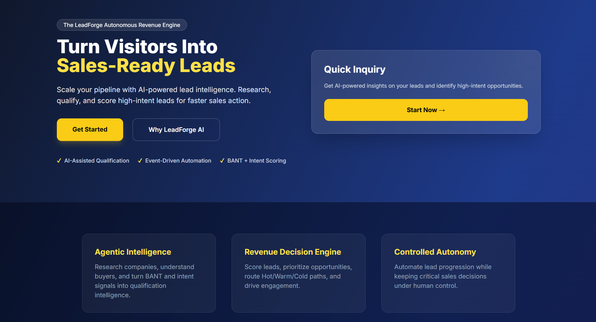
</p>

The main entry point to LeadForge AI, introducing the platform's AI-powered lead qualification and revenue automation capabilities.

### 2. Lead Inquiry Form

<p align="center">
  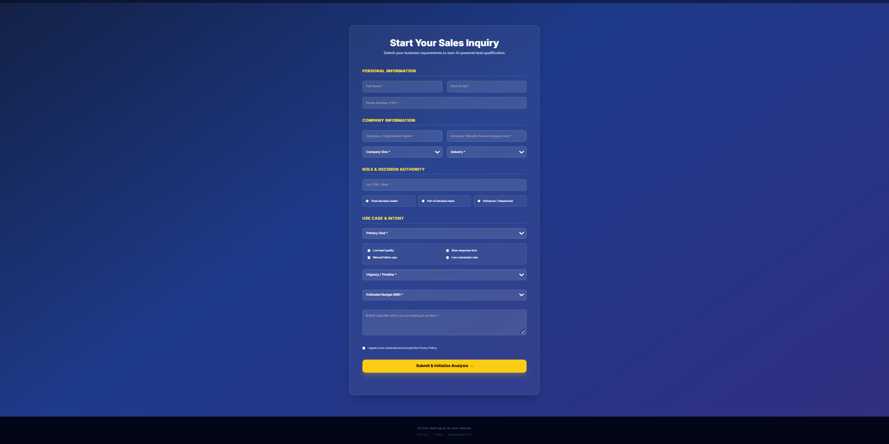
</p>

Captures customer and company information, decision-making authority, business requirements, urgency, and estimated budget to support lead qualification.

### 3. Submission Acknowledgment

<p align="center">
  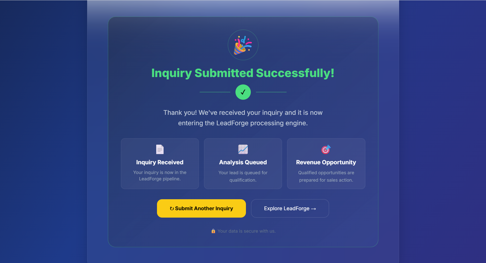
</p>

Confirms successful inquiry submission and informs the user that the lead is entering the LeadForge processing workflow.

---

## ⚙️ Automation Workflows

### 4. Inbound Processing Workflow

<p align="center">
  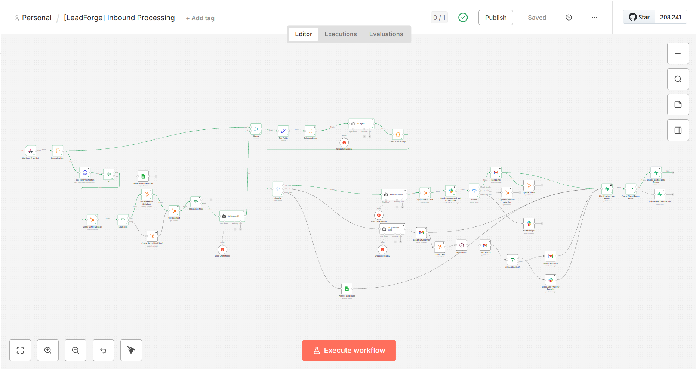
</p>

Receives inbound inquiries, validates lead information, performs AI-assisted analysis and qualification, calculates lead scores, classifies leads, and synchronizes relevant data with connected systems.

### 5. Automated Follow-up Workflow

<p align="center">
  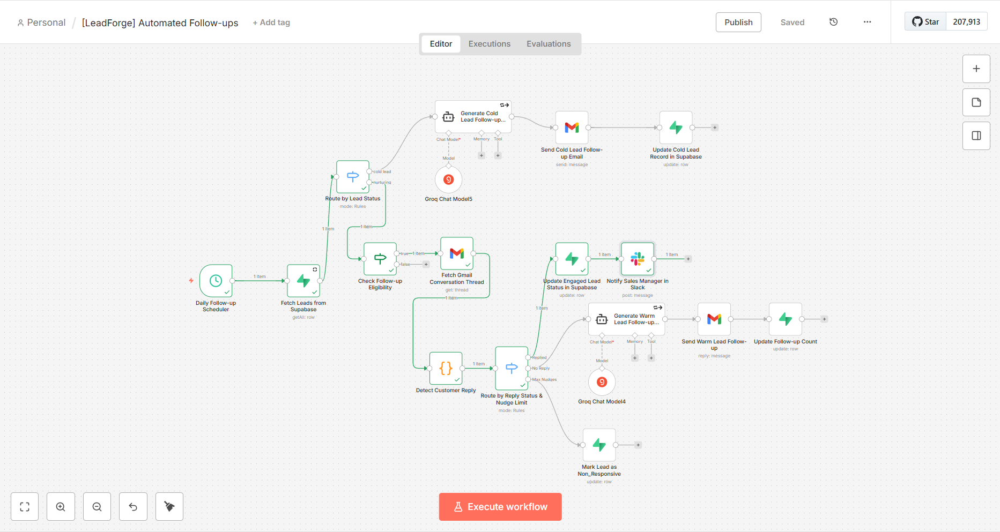
</p>

Evaluates eligible warm leads on a schedule, checks Gmail conversation activity, generates personalized follow-up emails when appropriate, and updates lead state throughout the nurturing process.

### 6. Error Monitoring Workflow

<p align="center">
  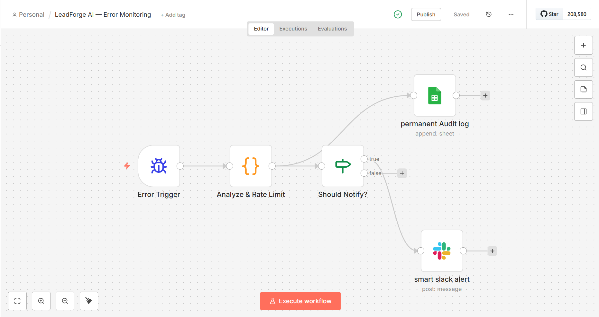
</p>

Processes workflow execution failures, analyzes available error context, applies notification rate limiting, records audit information, and sends operational alerts through Slack.

---

## 🤝 Sales & Human-in-the-Loop

### 7. Hot Lead Approval

<p align="center">
  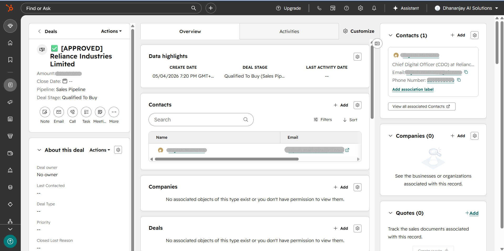
</p>

Presents a high-intent lead's AI-generated intelligence briefing and proposed sales email for human review before the configured sales action proceeds.

### 8. Hot Lead Approval Request

<p align="center">
  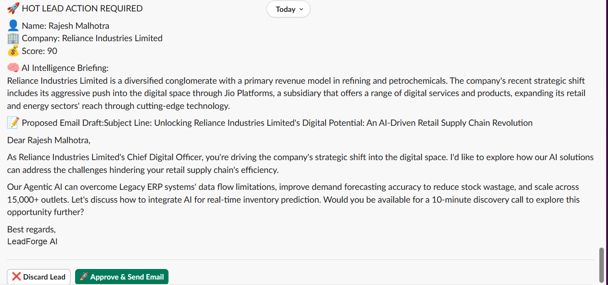
</p>

Displays the lead context, qualification score, AI-generated sales content, and approval controls. The manager can approve the proposed email for sending or discard the lead.

### 9. Warm-to-Hot Lead Handover

<p align="center">
  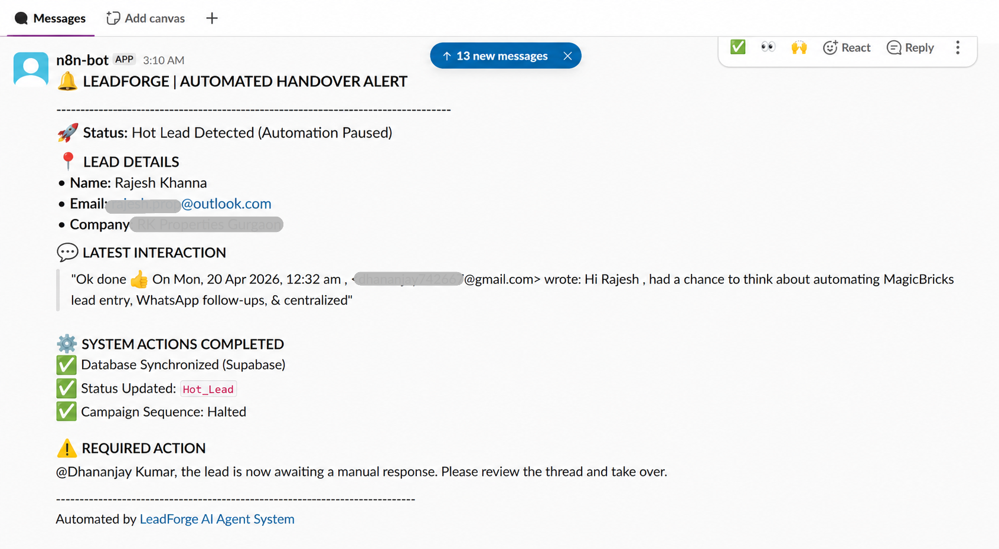
</p>

Demonstrates an engagement-driven sales handover in which a customer reply triggers the configured transition from automated nurturing to human sales follow-up.

---

## 🔗 Integrations & Operational State

### 10. HubSpot CRM Synchronization

<p align="center">
  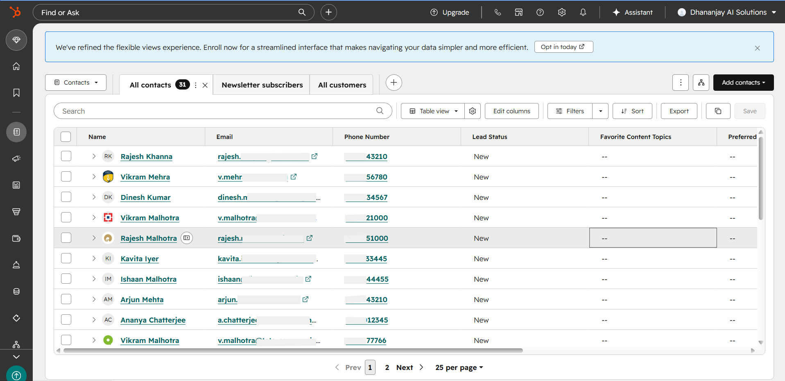
</p>

Demonstrates CRM integration for maintaining contact, deal, and lead lifecycle information across the configured sales workflows.

### 11. Supabase Operational State

<p align="center">
  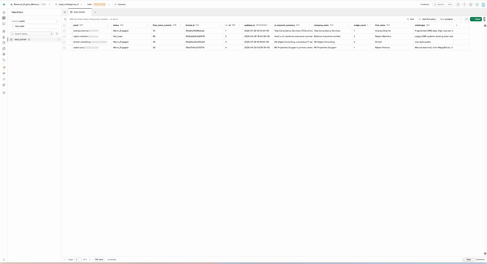
</p>

Shows the operational state stored in Supabase/PostgreSQL, including lead status, qualification score, Gmail thread context, AI research summaries, company information, nurture count, and workflow timestamps.

### 12. Slack Notifications

<p align="center">
  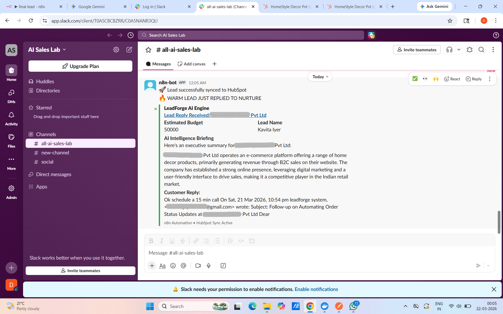
</p>

Provides visibility into relevant sales events, customer engagement, lead handovers, and workflow failures through Slack notifications.</p>

---

*Note: Screenshots illustrate the portfolio implementation using synthetic test records. They demonstrate configured workflows and integrations, not production customer activity.*

# 🎥 Demo Video

A complete walkthrough of LeadForge AI will be added here, demonstrating the end-to-end lead qualification pipeline, AI-assisted sales decisions, automated follow-ups, and connected business systems.

Demo video coming soon.
---

# 🚀 Getting Started

Follow the steps below to set up LeadForge AI locally, configure its integrations, and test the automation workflows.

## Prerequisites

Before you begin, ensure you have:

- [Git](https://git-scm.com/) installed
- [Docker](https://www.docker.com/) installed and running
- A modern web browser
- Access to the required third-party services and API credentials

### 1. Clone the Repository

```bash
git clone https://github.com/YOUR_USERNAME/LeadForge-AI.git
cd LeadForge-AI
```

Replace `YOUR_USERNAME` with your GitHub username.

### 2. Run the Frontend

LeadForge AI uses HTML, Tailwind CSS, and JavaScript for its frontend.

For a basic interface preview, open `index.html` in your browser.

To test form submissions and webhook communication, serve the project through a local development server, such as the VS Code Live Server extension.

### 3. Start n8n Locally

Run n8n using Docker:

```bash
docker run -d \
  --name leadforge-n8n \
  -p 5678:5678 \
  -v leadforge_n8n_data:/home/node/.n8n \
  docker.n8n.io/n8nio/n8n
```

Open [http://localhost:5678](http://localhost:5678) in your browser and complete the initial setup if prompted.

To stop the container:

```bash
docker stop leadforge-n8n
```

To start it again:

```bash
docker start leadforge-n8n
```

### 4. Import the Automation Workflows

Import the exported workflow JSON files from the `n8n/` directory into your n8n instance:

- `inbound-processing.json`
- `automated-followups.json`
- `error-handler.json`

After importing, review the nodes, configure the required credentials, and verify the workflow settings before activating each workflow.

### 5. Configure Integrations

Configure the credentials required by your imported workflows in n8n.

| Integration | Purpose |
|---|---|
| Groq | AI inference and lead analysis |
| ZeroBounce | Email validation |
| HubSpot | Contact and deal management |
| Supabase | Operational data and lead state |
| Gmail | Email sending and conversation handling |
| Slack | Sales and operational notifications |
| Google Sheets | Operational tracking |

The exact configuration depends on the nodes and operations enabled in each workflow. Imported workflow JSON files do not include your personal service credentials.

### 6. Configure the Frontend Webhook

Open `js/script.js` and locate the webhook URL configuration.

Set it to the appropriate endpoint for your n8n environment.

- **Test mode:** Use the test webhook URL while the workflow is waiting for a test event.
- **Production mode:** Activate the workflow and use its production webhook URL.

Ensure that the frontend sends the payload expected by the webhook. Configure appropriate cross-origin access settings if required.

**Important:** Do not commit private webhook URLs, API keys, access tokens, or other secrets to GitHub.

### 7. Test the End-to-End Workflow

Use synthetic test records to verify the configured functionality.

- Submit an inquiry through the frontend.
- Verify lead validation, AI-assisted qualification, scoring, and Hot/Warm/Cold classification.
- Confirm the expected HubSpot and Supabase updates.
- Test the Hot Lead approval process.
- Verify Gmail reply detection and follow-up behavior.
- Confirm that the relevant Slack notifications are delivered.
- Test error handling using a controlled failure scenario.

Verify each workflow independently before enabling automated email delivery.

### Troubleshooting

- **Webhook errors:** Verify the endpoint URL, workflow activation state, and expected request payload.
- **CORS errors:** Check the development server origin and the webhook's cross-origin configuration.
- **Credential errors:** Confirm that the required n8n credentials are configured and authorized.
- **Missing database updates:** Verify Supabase connection settings, table structure, and access policies.
- **Missing notifications:** Check the relevant workflow execution and Slack credential configuration.

### Security & Deployment Notes

- Use synthetic data during development and testing.
- Configure and verify Supabase Row Level Security (RLS) policies.
- Protect public webhook endpoints with appropriate authentication and access controls.
- Review retry behavior, duplicate handling, and email-sending conditions before production use.
- Keep credentials in the appropriate secret or credential-management system.
- Validate all imported workflows and integration settings before enabling automated execution.

Actual behavior depends on the credentials, workflow configuration, and external services available in your environment.

---

# 🔮 Future Improvements

LeadForge AI provides a foundation for AI-assisted lead qualification, automated nurturing, human-controlled sales progression, CRM synchronization, and workflow monitoring.

Future development will focus on expanding the platform's scalability, intelligence, configurability, and operational reliability.

## 🚀 Planned Enhancements

- **Multi-Tenant SaaS Architecture**  
  Support multiple organizations with isolated data, configurable workflows, and organization-specific integrations.

- **Advanced Sales Analytics**  
  Introduce dashboards for lead volume, qualification scores, Hot/Warm/Cold distribution, follow-up engagement, and sales pipeline performance.

- **Configurable Lead Qualification**  
  Enable teams to customize BANT criteria, lead-scoring weights, routing rules, approval requirements, and follow-up limits.

- **Enhanced Lead Intelligence**  
  Incorporate additional company and prospect signals to enrich qualification context and improve lead prioritization.

- **Omnichannel Engagement**  
  Extend automated customer engagement beyond email through additional business communication channels.

- **AI Evaluation & Observability**  
  Introduce structured evaluation of AI-generated outputs, prompt versioning, execution metrics, and qualification-quality monitoring.

- **Automated Testing & CI/CD**  
  Add automated frontend tests, workflow validation, and version-controlled deployment pipelines to improve release reliability.

- **Scalable & Secure Infrastructure**  
  Strengthen webhook authentication, access controls, environment-specific configuration, and infrastructure scalability as usage grows.


  ## 👨‍💻 Built By

**Dhananjay Kumar**  
AI Automation Engineer | AI Agents & Workflow Systems

Building AI-powered automation systems and intelligent workflows that connect LLMs, business applications, and operational processes.

**Connect**

- [GitHub](https://github.com/dhananjay0015/)
- [LinkedIn](https://www.linkedin.com/in/dhananjay-kumar015/)

## 📄 License

**Copyright © 2026 Dhananjay Kumar. All rights reserved.**

LeadForge AI is made available for portfolio review and demonstration purposes only.

No permission is granted to reproduce, modify, redistribute, or commercially use this project without prior written permission from the copyright holder.

For licensing or commercial-use inquiries, please contact the copyright holder through the links in the [Built By](#-built-by) section.
